<!--
  Profile README for github.com/4bhimxnyu
  ---------------------------------------------------------------------------
  Plain Markdown with a little HTML. Edit anything freely, except:

    * the text between  STATS:START / STATS:END  and  REPOS:START / REPOS:END
    * assets/contributions-*.svg

  Those are rewritten every day by .github/workflows/update-stats.yml, which
  runs scripts/update_readme.py. Change the script to change them.

  The buttons are SVGs in assets/buttons/, generated by scripts/make_buttons.py.
  Each comes in a light and a dark version and the <picture> tag picks one to
  match the viewer's GitHub theme.
-->

# Abhimanyu Singh

Full-stack developer &nbsp;·&nbsp; B.Tech CSE at MIT ADT University, Pune &nbsp;·&nbsp; Intern at Mextropic AI

<a href="https://4bhimxnyu.vercel.app/resume/Abhimanyu_Singh_Resume.pdf"><picture><source media="(prefers-color-scheme: dark)" srcset="assets/buttons/resume-dark.svg"></picture></a>&nbsp;
<a href="https://4bhimxnyu.vercel.app"><picture><source media="(prefers-color-scheme: dark)" srcset="assets/buttons/portfolio-dark.svg"></picture></a>&nbsp;
<a href="https://www.linkedin.com/in/4bhimxnyu/"><picture><source media="(prefers-color-scheme: dark)" srcset="assets/buttons/linkedin-dark.svg"></picture></a>&nbsp;
<a href="mailto:abhimanyupratapsingh30nov1106@gmail.com"><picture><source media="(prefers-color-scheme: dark)" srcset="assets/buttons/email-dark.svg"></picture></a>

 

I build products end to end, from the interface people use to the systems that run it.
Right now I'm building the web platform for an AI drug-discovery data startup at Mextropic AI.
Before that I shipped a teacher and student app to iOS at SuprSchool and built the website
for a hospitality brand at Bunkout.

## Experience

**Mextropic AI** · Full-Stack Developer Intern · Sep 2026 – present
- Built and deployed the company website with React, Vite and an Express API running as a Vercel serverless function.
- Developed REST endpoints for the data catalogue, campaign data and a rate-limited enquiry form.
- Turned Figma designs into responsive React components and shipped a second, minimalist design variant for review.

**SuprSchool** · Full-Stack Developer · Apr 2026 – Aug 2026
- Shipped features and fixes for a school app built with Expo (React Native) and a TypeScript Express API on Supabase, released to iOS through TestFlight.
- Fixed real-time notification delivery end to end, from the Postgres queue worker to the realtime channel the client subscribes to.
- Wrote contract tests that check every client API call against the server's routes, and added request timeouts, cursor pagination and idempotency keys.
- Reduced iOS releases to a single command with EAS Build and Submit profiles.

**Bunkout** · Full-Stack Developer · Jan 2026 – Mar 2026 · [bunkout.in](https://bunkout.in)
- Built the Next.js website for a stays and hospitality brand with 52K+ Instagram followers: listings, room galleries and menus.
- Designed an admin dashboard for managing listings and site content.

## Projects

| Project | Built with | What it is |
|:--|:--|:--|
| [Shaolin Baddie](https://github.com/4bhimxnyu/Pixel-Art-Adventure-Game.) | TypeScript, React 19, Phaser 3, Zustand | A 12-map pixel-art RPG with turn-based battles, missions and save states. All art and music are generated at runtime with Canvas and Web Audio. |
| [Redis Weather App](https://github.com/4bhimxnyu/Redis-based-weather-app.) | Node.js, Express, Redis, Docker, GitHub Actions | A forecast service that caches Open-Meteo responses in Redis with a 10-minute TTL and keeps working when Redis is down. Docker Compose, tested in CI. |
| [Nexus](https://github.com/4bhimxnyu/Scrum-Local-LLM) | Python, Ollama, Gemma 2B | An offline chatbot that runs on a consumer GPU, with a custom Modelfile for persona and document Q&A. No cloud APIs. |
| [Portfolio](https://github.com/4bhimxnyu/2026v-Portfolio) | Next.js 16, React 19, three.js, Web Audio | My site, with a WebGL hero, a 3D skills field and a physically modelled bass you can play. |
| [Mextropic AI website](https://github.com/4bhimxnyu/Mextropic-AI-) | React, Vite, Express, Vercel | A responsive build of the Figma spec for an AI drug-discovery data startup. |

## Skills

- **Languages:** TypeScript, JavaScript, Python, Java, SQL, HTML, CSS
- **Frontend:** React, Next.js, React Native, Expo, Vite, Tailwind CSS, Zustand, TanStack Query
- **Backend:** Node.js, Express, REST APIs, Zod, JWT authentication
- **Databases:** PostgreSQL, Supabase, Redis, MongoDB, Drizzle ORM
- **DevOps and tools:** Docker, GitHub Actions, Git, Vercel, Netlify, EAS, TestFlight, Vitest, Figma
- **AI:** LLMs, Ollama, AI-assisted development with Claude Code

## GitHub

<!-- STATS:START -->
<!-- Generated daily by scripts/update_readme.py. Edit the script, not this block. -->
| On GitHub since | Days with contributions | Total commits | Public repositories |
|:--|:--|:--|:--|
| December 2022 (1,413 days) | 201 | 576 | 34 |

Updated 29 Oct 2026.
<!-- STATS:END -->

<picture>
  <source media="(prefers-color-scheme: dark)" srcset="assets/contributions-dark.svg">
  
</picture>

**Most committed repositories**

<!-- REPOS:START -->
<!-- Generated daily by scripts/update_readme.py from commit counts. Edit the script, not this table. -->
| Repository | Commits | Language | Last push |
|:--|--:|:--|:--|
| [Cohort_Playlist](https://github.com/4bhimxnyu/Cohort_Playlist) | 122 | JavaScript | 2026-03-24 |
| [Pixel-Art-Adventure-Game.](https://github.com/4bhimxnyu/Pixel-Art-Adventure-Game.) | 105 | TypeScript | 2026-10-17 |
| [Data-Structure-Algorithm.py](https://github.com/4bhimxnyu/Data-Structure-Algorithm.py) | 62 | Python | 2024-12-14 |
| [TextForm-WebPlay](https://github.com/4bhimxnyu/TextForm-WebPlay) | 50 | JavaScript | 2025-01-14 |
| [What-i-ve-Built](https://github.com/4bhimxnyu/What-i-ve-Built) | 50 | JavaScript | 2026-07-10 |
| [Fibonacci.exe](https://github.com/4bhimxnyu/Fibonacci.exe) | 25 | HTML | 2025-01-06 |
| [Mongo-database-tutorial](https://github.com/4bhimxnyu/Mongo-database-tutorial) | 20 | JavaScript | 2024-12-13 |
| [4bhimxnyu](https://github.com/4bhimxnyu/4bhimxnyu) | 15 | Python | 2026-10-28 |
<!-- REPOS:END -->

 

<a href="mailto:abhimanyupratapsingh30nov1106@gmail.com">abhimanyupratapsingh30nov1106@gmail.com</a> &nbsp;·&nbsp;
<a href="https://www.linkedin.com/in/4bhimxnyu/">LinkedIn</a> &nbsp;·&nbsp;
<a href="https://4bhimxnyu.vercel.app">4bhimxnyu.vercel.app</a> &nbsp;·&nbsp;
<a href="https://www.behance.net/abhimanyusingh92">Behance</a>
 Off the keyboard I play bass. Runner-up, National Battle of Bands, CBIT.

