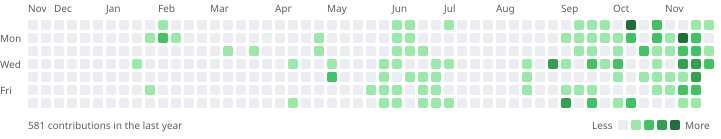

<!--
  Profile README for github.com/4bhimxnyu
  ---------------------------------------------------------------------------
  Plain Markdown with a little HTML. Edit anything freely, except:

    * the text between  STATS:START / STATS:END  and  REPOS:START / REPOS:END
    * assets/contributions-*.svg

  Those are rewritten every day by .github/workflows/update-stats.yml, which
  runs scripts/update_readme.py. Change the script to change them.

  The buttons are SVGs in assets/buttons/, generated by scripts/make_buttons.py.
  Each comes in a light and a dark version and the <picture> tag picks one to
  match the viewer's GitHub theme.
-->

# Abhimanyu Singh

Full-stack developer &nbsp;·&nbsp; B.Tech CSE at MIT ADT University, Pune &nbsp;·&nbsp; Intern at Mextropic AI

<a href="https://4bhimxnyu.vercel.app/resume/Abhimanyu_Singh_Resume.pdf"><picture><source media="(prefers-color-scheme: dark)" srcset="assets/buttons/resume-dark.svg"></picture></a>&nbsp;
<a href="https://4bhimxnyu.vercel.app"><picture><source media="(prefers-color-scheme: dark)" srcset="assets/buttons/portfolio-dark.svg"></picture></a>&nbsp;
<a href="https://www.linkedin.com/in/4bhimxnyu/"><picture><source media="(prefers-color-scheme: dark)" srcset="assets/buttons/linkedin-dark.svg"></picture></a>&nbsp;
<a href="mailto:abhimanyupratapsingh30nov1106@gmail.com"><picture><source media="(prefers-color-scheme: dark)" srcset="assets/buttons/email-dark.svg"></picture></a>

 

I build products end to end, from the interface to the systems behind it.

## 💼 Experience

- **Mextropic AI** · Full-Stack Developer Intern · Sep 2026 – present Company website and REST API with React, Vite and Express on Vercel.
- **SuprSchool** · Full-Stack Developer · Apr – Aug 2026 School app in Expo and Express on Supabase, shipped to iOS through TestFlight.
- **Bunkout** · Full-Stack Developer · Jan – Mar 2026 · [bunkout.in](https://bunkout.in) Next.js website and admin dashboard for a hospitality brand.

## 🚀 Projects

<!-- REPOS:START -->
<!-- Generated daily by scripts/update_readme.py: your most recently pushed repos. Edit the script, not this table. -->
| Project | What it is | Language | Updated |
|:--|:--|:--|:--|
| [ancesra-website](https://github.com/4bhimxnyu/ancesra-website) · [live](https://ancesra.vercel.app) | Website for ancesra ai, the free AI assistant that runs 100% offline on your laptop | JavaScript | 23 Nov 2026 |
| [Ancesra-releases](https://github.com/4bhimxnyu/Ancesra-releases) · [live](https://ancesra.vercel.app) | Download Ancesra AI (formerly Nexus) | — | 19 Nov 2026 |
| [Mextropic-AI-](https://github.com/4bhimxnyu/Mextropic-AI-) · [live](https://site-seven-blush-91.vercel.app) | Website for Mextropic AI, lab data infrastructure for AI-led drug discovery | JavaScript | 29 Oct 2026 |
| [Redis-based-weather-app](https://github.com/4bhimxnyu/Redis-based-weather-app.) · [live](https://redis-based-weather-app.vercel.app) | A responsive weather forecasting app built with vanilla HTML, CSS, JavaScript, Express.js, and Redis caching,… | JavaScript | 22 Oct 2026 |
| [Pixel-Art-Adventure-Game](https://github.com/4bhimxnyu/Pixel-Art-Adventure-Game.) · [live](https://shaolin-baddie.vercel.app) | A browser-based, Pokémon-inspired wuxia pixel RPG made as a birthday gift | TypeScript | 17 Oct 2026 |
| [2026v-Portfolio](https://github.com/4bhimxnyu/2026v-Portfolio) · [live](https://4bhimxnyu.vercel.app) | Personal portfolio of Abhimanyu Singh, full stack developer and bassist | JavaScript | 12 Oct 2026 |
<!-- REPOS:END -->

## 🛠️ Skills

- **Languages:** TypeScript, JavaScript, Python, Java, SQL
- **Frontend:** React, Next.js, React Native, Expo, Tailwind CSS
- **Backend:** Node.js, Express, PostgreSQL, Supabase, Redis, MongoDB
- **Tools:** Docker, GitHub Actions, Vercel, Git, Figma, Ollama

## 📊 GitHub

<!-- STATS:START -->
<!-- Generated daily by scripts/update_readme.py. Edit the script, not this block. -->
| On GitHub since | Days with contributions | Total commits | Public repositories |
|:--|:--|:--|:--|
| December 2022 (1,440 days) | 222 | 616 | 35 |

Updated 25 Nov 2026.
<!-- STATS:END -->

<picture>
  <source media="(prefers-color-scheme: dark)" srcset="assets/contributions-dark.svg">
  
</picture>

 

<a href="mailto:abhimanyupratapsingh30nov1106@gmail.com">abhimanyupratapsingh30nov1106@gmail.com</a> &nbsp;·&nbsp;
<a href="https://www.linkedin.com/in/4bhimxnyu/">LinkedIn</a> &nbsp;·&nbsp;
<a href="https://4bhimxnyu.vercel.app">4bhimxnyu.vercel.app</a> &nbsp;·&nbsp;
<a href="https://www.behance.net/abhimanyusingh92">Behance</a>

